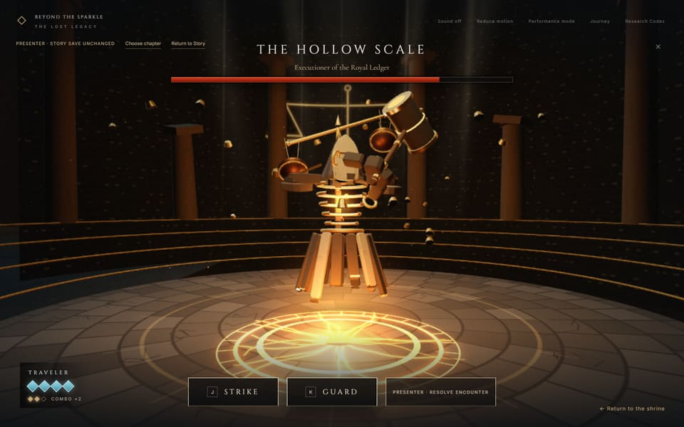
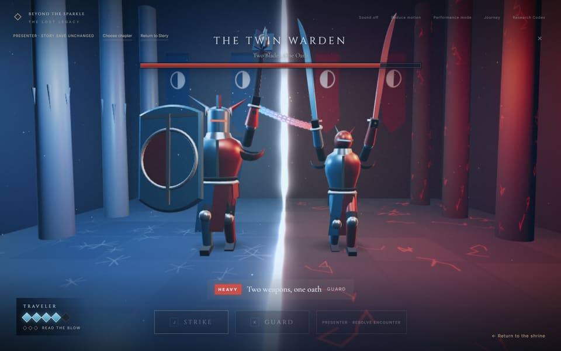
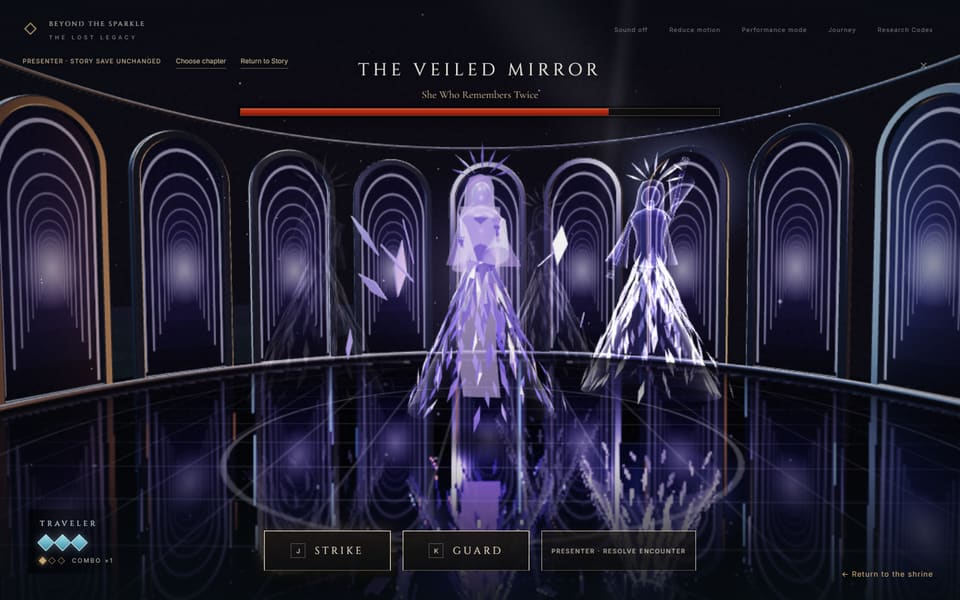
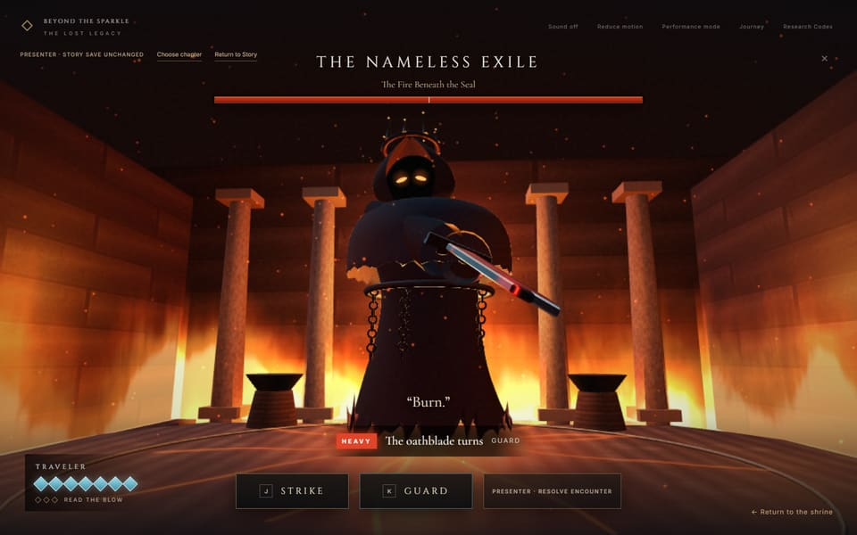

# Beyond the Sparkle: The Lost Legacy

**A 3D story game in the browser, built on a real data-science study of 53,940 diamonds.**

[](https://github.com/ShadenAqeel/beyond-the-sparkle/actions/workflows/pages.yml)

### ▶ [Play now: shadenaqeel.github.io/beyond-the-sparkle](https://shadenaqeel.github.io/beyond-the-sparkle/)

There is nothing to install: open the link in Chrome, Edge, Firefox or Safari on a laptop or desktop. A full playthrough takes about 6–8 minutes, plus optional research.

<table>
  <tr>
    <td></td>
    <td></td>
  </tr>
  <tr>
    <td></td>
    <td></td>
  </tr>
</table>

## About

Three diamonds were taken from a forgotten kingdom, and three corrupted guardians bar their return. You explore a candle-lit shrine, defeat each guardian, return its diamond and wake the scholar who guarded it. Each scholar remembers a different part of the truth, and each part is a real step in a clustering study:

| Chapter | Guardian | Research idea |
| --- | --- | --- |
| Form | The Hollow Scale | Cleaning and standardizing six physical measurements |
| Division | The Twin Warden | Two K-Means groups of diamonds |
| Memory | The Veiled Mirror | PCA: two components keep 88.12% of the variance |
| Beyond the boundary | The Nameless Exile | DBSCAN and the observations left outside the clusters |

Every number in the game comes from the verified export of the original notebook. The browser never fits a model.

## Features

- **Four distinct boss fights**, each with its own procedurally built guardian, arena, lighting and particle effects. Every guardian has its own idle personality, readable attack telegraphs, hit reactions and defeat.
- **Turn-based combat about reading your opponent:** strike an opening for a critical hit, guard a real blow to parry, and chain good reads into a finisher. The final boss changes its pattern when enraged.
- **Interactive discoveries:** find an impossible record in the real CSV data, compare group profiles, and fold six measurements into a live PCA projection.
- **Research Codex:** local interactive charts (Plotly) for distributions, K-Means, PCA variance and DBSCAN, plus a downloadable copy of the original notebook.
- **Saves automatically:** progress is stored in your browser, and **Continue Journey** resumes it.
- **Presenter Mode** for live demos: jump to any chapter or resolve a battle instantly without touching the saved story.
- **Runs on ordinary laptops:** Performance Mode is on by default, with an optional Quality Mode. There is also a Reduce motion option, and the synthesized sound starts muted.

## How to play

| Action | Mouse | Keyboard |
| --- | --- | --- |
| Approach an object | Click its marker | Tab / Enter |
| Strike | **Strike** button | J, A or ← |
| Guard | **Guard** button | K, D or → |
| Close a panel / step back | × | Esc |

Start at the **living flame**: it opens all three chambers. An empty pedestal also offers its own chamber. Watch the cue above the buttons: **HEAVY** means guard; **OPENING** means strike.

**Requirements:** a browser with WebGL 2 and hardware acceleration enabled, used with a mouse and keyboard.

## Run it locally

You need [Node.js](https://nodejs.org/) 22.12 or newer. The game lives in [`prototype-3d/`](prototype-3d/).

```sh
git clone https://github.com/ShadenAqeel/beyond-the-sparkle.git
cd beyond-the-sparkle/prototype-3d
npm ci
npm run dev
```

Open the printed address, normally http://127.0.0.1:5173/. On Windows PowerShell, use `npm.cmd` if script execution is blocked.

To try the exact production build that GitHub Pages serves:

```sh
npm run build
npm run preview -- --port 4173
```

Then open http://127.0.0.1:4173/. Don't open `dist/index.html` directly: browsers block its modules and data under `file://`.

## Deployment

Every push to `main` runs [`.github/workflows/pages.yml`](.github/workflows/pages.yml), which:

1. installs dependencies with `npm ci` (Node 22),
2. runs the unit tests (game rules, saves and research data),
3. builds `prototype-3d/` with Vite and checks that every model, texture, dataset and chart library is in the bundle,
4. publishes `prototype-3d/dist` to GitHub Pages.

The build uses a relative base path (`./`) and every asset URL is built from it. The same build therefore works at `https://<user>.github.io/beyond-the-sparkle/`, at a custom-domain root and in local preview. The game has no client-side routes, so Pages needs no rewrite or 404 configuration.

Saves are stored per website address. Progress made on one address (for example localhost or a custom domain) does not carry over to another.

## Tests

From `prototype-3d/`:

```sh
npm run test:unit            # game rules, save system, verified research data
node tools/smoke-combat.mjs  # plays real fights in a browser (start `npm run dev` first; set BROWSER_PATH to Chrome or Edge)
npx playwright test          # full browser suite (uses Microsoft Edge by default)
```

## Project structure

```text
prototype-3d/            The 3D game (Vite + Three.js); this is what is deployed
  src/                   Game code: scenes, guardians, arenas, combat, saves, Codex
  public/                Models, textures, verified data, Plotly, notebook, licenses
  tests/, checks/, tools/  Browser tests, unit tests, QA and profiling tools
  README.md              Detailed design, accessibility and maintenance notes
data/, reference/        Verified research export and the original notebook and dataset
scripts/                 Python exporter that reproduces the research results
index.html, js/, css/    The earlier 2D prototype (Milestone 1), kept for reference
```

## Reproducing the research

The research values were exported from the original notebook and checked against it. To reproduce them (Python 3.11+):

```sh
python -m venv .venv
.venv\Scripts\activate         # macOS/Linux: . .venv/bin/activate
pip install -r requirements.txt
python scripts/export_notebook_data.py
```

The verified results: 53,940 → 53,893 rows after cleaning, six standardized physical features, two K-Means groups (silhouette 0.429 before PCA, 0.487 after), two principal components retaining 88.12% of the variance, and DBSCAN with one main cluster and 311 noise observations after PCA. The two silhouette scores are computed in different spaces, so they do not by themselves prove an overall improvement.

## Credits and licenses

- Scholar characters are adapted from **Old Man** by Bake3D ([CC BY 4.0](https://creativecommons.org/licenses/by/4.0/)). The four guardians and their arenas are original procedural geometry, canvas textures and shaders.
- [Three.js](https://threejs.org/) (MIT) and [Plotly.js](https://plotly.com/javascript/) (MIT).
- Cinzel, Cormorant Garamond and Inter fonts (SIL Open Font License).
- License texts ship with the game in `prototype-3d/public/licenses/`, `public/models/LICENSE.txt` and `public/vendor/`. Asset details are in [`prototype-3d/art-source/PROVENANCE.md`](prototype-3d/art-source/PROVENANCE.md).

The story and its symbols are original fiction; the gemstones are story chapters, not statistical clusters.
